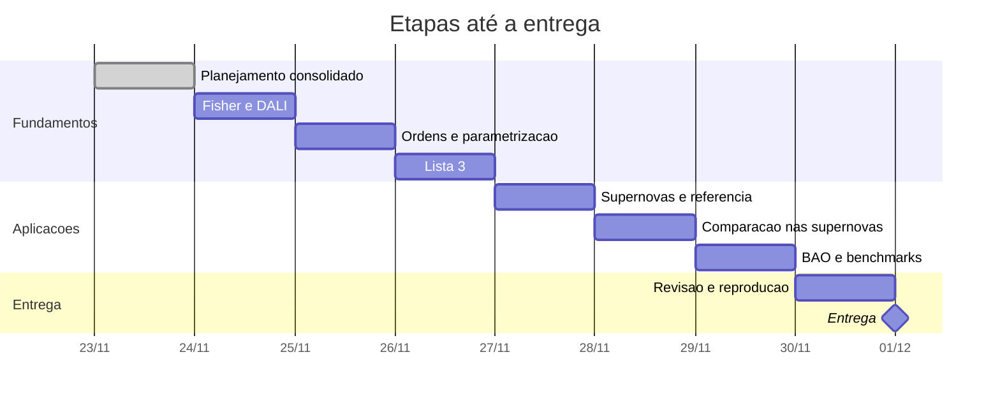

# A persistência da não Gaussianidade - Fisher e DALI

---------------------------------------------------
Tema do Projeto: Higher-Order Fisher Matrix (DALI)
Autor: Igor Stellet 
Matéria: Estatística Bayesiana, CBPF, 2026/2
---------------------------------------------------

Nesse projeto, vamos estudar como a aproximação de Fisher pode ser estendida para o método DALI (*Derivative Approximation for LIkelihoods*), quais posterior conseguimos descrever com essa aproximação e emq eu situações o aumento da ordem vale a pena ou deixa de compensar pelo seu custo computacional.

O percurso do projeto está pensado da seguinte forma: Começamos pela construção matemática do método, fazemos exemplos controlados e fazemos um exemplo da Lista 3 do curso, que evidencia o tratamento das não gaussianidades. Após essas aplicações simples, aplicamos o método em dados de supernovas, reproduzindo o artigo mostrado em sala e também aplicamos a medidas de BAO, proveniente de galáxias, buscando fazer uma aplicação nova.

O título do projeto é uma referência a obra *A Persistência da Memória*, de salvador Dali, cujo quadro pode ser visto no [MoMA](https://www.moma.org/collection/works/79018). A passagem de elipses (Fisher) para contornos deformados motiva o nome DALI e, por isso, vamos fazer como tarefa criativa tentar reproduzir as não Gaussianidades nesse projeto.


Entrega: Em um único [notebook principal](projeto_dali.ipynb), que terá todos os resultados principais, acompanhado de funções que utilizaremos de forma constante e que poder ser reaproveitadas em outros trabalhos em um módulo Python](src/dali.py) e desta documentação. O notebook contém a explicação cinetífica completa: hipóteses, deduções, implmentações, gráficos, resultados, limitações e referências.


*Figura de orientação.* Modelo com dados $d=(0,0)$, predição $\mu(x,y)=(x,y-0.55x^2)$, covariância $\operatorname{diag}(1,0.45^2)$ e priors uniformes no retângulo $x\in[-3,3]$, $y\in[-1.8,5.6]$. Os contornos encerram 68,3% e 95,4% da probabilidade conjunta de cada distribuição normalizada. A expansão do modelo até segunda ordem é exata neste exemplo. O [código da figura](figuras/gerar_visao_geral.py) acompanha os arquivos.


## Sumário | README

- [1. Pergunta central e objetivos](#1-pergunta-central-e-objetivos)
- [2. Perguntas guias do trabalho e seu escopo](#2-perguntas-guias-do-trabalho-e-seu-escopo)
- [3. Sequência do notebook único](#3-sequência-do-notebook-único)
- [4. Organização e execução](#10-organização-e-execução)
- [5. Etapas e cronograma](#11-etapas-e-cronograma)
- [6. Critérios de conclusão e acompanhamento](#12-critérios-de-conclusão-e-acompanhamento)
- [7. Referências e leituras dirigidas](#13-referências-e-leituras-dirigidas)

## 1. Pergunta central e objetivos

> **Quando aumentar a ordem de DALI melhora a aproximação de uma posterior, quanto custa essa melhora e como a resposta depende da parametrização e das priors?**

Para responder a essa pergunta, pretendo:

1. Construir Fisher a partir de um modelo probabilístico e interpretar sua geometria.
2. Derivar a expansão de DALI e explicar a reorganização dos termos por ordem de derivadas do modelo.
3. Distinguir singleto, dubleto e tripleto, incluindo suas hipóteses e seus custos.
4. Estudar exemplos em que a aproximação é exata, exemplos em que melhora e exemplos em que cria estruturas duplicadas/"espúrias".
5. Investigar a escolha de parâmetros preservando o mesmo problema estatístico e a mesma prior física.
6. Aplicar a construção à posterior da Lista 3 e usá-la como validação matemática do código.
7. Reproduzir metodologicamente a aplicação a supernovas do artigo original e estender a análise para BAO e combinação de observáveis.
8. Medir a precisão e o custo das aproximações quando avaliadas em malhas ou utilizadas em MCMC.

A partir dessas análises faremos conclusões sobre o método de DALI, suas vantagens, desvantagens e limitações

## 2.  Perguntas guias do trabalho e seu escopo

O núcleo do trabalho usará modelos com covariância dos dados independente dos parâmetros e expansões até o **tripleto**. A quarta ordem aparecerá, quando útil, como fechamento analítico de um exemplo polinomial. A extensão geral para covariâncias dependentes de parâmetros será contextualizada nas referências.

| Pergunta | Experimento ou comparação |
|---|---|
| O que torna uma posterior gaussiana nos parâmetros? | Modelo linear, ruído gaussiano e variação das priors. |
| Como os termos de DALI deformam as elipses? | Modelo quadrático com uma posterior curva. |
| Uma ordem maior sempre melhora a aproximação? | Exemplos inverso e polinomial; comparação de modos e massa de probabilidade. |
| Dubleto e tripleto podem criar modos espúrios ao mesmo tempo? | Contraexemplo explícito com solução conhecida. |
| A escolha de parâmetros melhora a aproximação ou muda a inferência? | Mesma likelihood e prior física, com jacobianos corrigidos. |
| Como Fisher e DALI se comportam na Lista 3? | Comparação com a posterior completa, cortes, marginais e probabilidades. |
| O método funciona numa aplicação observacional? | Supernovas em wCDM plano. |
| Combinar observáveis torna Fisher mais adequado ou aumenta a vantagem de DALI? | Supernovas, BAO e combinação dos conjuntos. |
| Quando o preparo de DALI compensa? | Tempos de preparação e avaliação, erro estatístico e exploração numérica. |

A investigação própria estará na seleção e reconstrução dos exemplos, nos testes de validade, na análise da parametrização, nas comparações quantitativas e na interpretação dos resultados. Uma solução desenvolvida no projeto não será chamada de inédita na literatura sem uma investigação específica dessa prioridade.

## 3. Sequência do notebook único

O arquivo [projeto_dali.ipynb](projeto_dali.ipynb) será dividio em blocos. Cada seção contém uma pergunta, a notação necessária, as hipóteses, a dedução, o código e uma discussão das saídas.

| Bloco | Conteúdo | Resultado esperado |
|---|---|---|
| **0. Leitura e execução** | Objetivos, sumário, ambiente, convenções e configurações. | Permitir acompanhar e reproduzir o trabalho. |
| **1. Modelo probabilístico e Fisher** | Dados, likelihood, prior, posterior, informação e curvatura. | Construir a aproximação gaussiana e interpretar suas condições. |
| **2. Hierarquia de DALI** | Expansão do modelo, termos cruzados e tratamento das priors. | Derivar singleto, dubleto e tripleto. |
| **3. Exemplos controlados** | Modelos linear, quadrático, inverso e contraexemplo. | Identificar mecanismos de sucesso e falha. |
| **4. Aplicação à Lista 3** | Cortes, marginais, não gaussianidade e comparação com a questão 5. | Validar a construção quadrática e discutir o conteúdo perdido por Fisher. |
| **5. Supernovas** | Dados, cosmologia, calibração, referência e aproximações. | Reproduzir a aplicação principal do artigo. |
| **6. BAO e combinação de observáveis** | Dados comprimidos de galáxias, covariância e inferência conjunta. | Avaliar a mudança das degenerescências e da precisão. |
| **7. Oficina visual** | Posterior com contornos deformados inspirados em Dalí. | Explorar o alcance local e global das aproximações de forma ilustrativa. |
| **8. Precisão e custo** | Métricas, tempos, convergência e ponto de compensação. | Comparar desempenho com a qualidade da inferência controlada. |
| **9. Síntese e referências** | Respostas às perguntas, limitações e próximos passos. | Relacionar os resultados às hipóteses de cada estudo. |

O objetivo é que a leitura seja gradual e fluida, com um bloco guiando o próximo. Os módulos `.py` concentrarão as funções recorrentes; sua interpretação e seu uso permanecerão explicados nas células Markdown no noteobok!.

## 4. Organização e execução

### 4.1 Arquivos iniciais e estrutura prevista

| Caminho dentro de `projeto/` | Papel | Situação |
|---|---|---|
| [`README.md`](README.md) | Planejamento, navegação, referências e acompanhamento. | Criado. |
| [`projeto_dali.ipynb`](projeto_dali.ipynb) | Único documento científico principal. | Introdução, configuração e roteiro criados; análise a desenvolver. |
| [`src/dali.py`](src/dali.py) | Funções principais reutilizáveis. | Módulo inicial; funções a desenvolver junto das derivações. |
| [`src/__init__.py`](src/__init__.py) | Organização dos módulos Python. | Criado. |
| [`figuras/gerar_visao_geral.py`](figuras/gerar_visao_geral.py) | Código da figura de orientação. | Criado e executado. |
| [`figuras/visao_geral_fisher_dali.png`](figuras/visao_geral_fisher_dali.png) e versão SVG | Figura de orientação. | Criadas. |
| `tests/` | Testes científicos e numéricos. | Planejado. |
| `data/` | Dados utilizados e sua procedência. | Planejado. |
| `tabelas/` | Tabelas geradas pelas análises. | Planejado. |
| Arquivo de requisitos e instalador do projeto | Instalação na `.venv` da raiz. | Definição ao concluir as dependências. |

 Uma documentação `.md` específica das funções poderá ser preparada ao final, depois de sua interface estar consolidada. Durante o desenvolvimento, docstrings e explicações no notebook acompanharão o código.

### 4.2 Ambiente compartilhado

O projeto seguirá a instalação incremental do [README central](../README.md). O ambiente fica na **`.venv` da raiz do repositório** e será reaproveitado pelos conjuntos de notebooks.

Para abrir o JupyterLab usando esse ambiente, a partir da raiz:

```bash
source .venv/bin/activate
python -m jupyterlab
```

Abra `projeto/projeto_dali.ipynb` e selecione o kernel **Análise Bayesiana (.venv)**. No Windows sem WSL, siga as instruções de ativação e execução do README central.

As células iniciais usam apenas a biblioteca padrão e o módulo local. Para reproduzir a figura deste README, NumPy e Matplotlib precisam estar disponíveis; ambos constam na instalação da base dos slides:

```bash
bash notebooks/exercicios_slides/instalar.sh
python projeto/figuras/gerar_visao_geral.py
```

O notebook localizará a pasta `projeto/` ao ser iniciado nessa pasta ou na raiz do repositório. Os caminhos das saídas serão construídos a partir dessa localização. As execuções caras terão configurações explícitas e as versões finais informarão como reproduzir as saídas apresentadas.

Ao concluir o projeto, prepararemos seus requisitos, seu verificador e seu instalador, além da instalação completa do repositório, sempre utilizando a mesma `.venv` da raiz.

## 5. Etapas e cronograma

Abaixo segue o calendário planejado para a produção desse projeto.

| Data | Foco | Entrega ou marco | Critério de avanço |
|---|---|---|---|
| **23/11** | Planejamento. | Pergunta, escopo, formato e roteiro, consolidados neste README. | Plano organizado para iniciar o notebook. |
| **24/11** | Fundamentos de Fisher e DALI. | Primeiras seções do notebook único, modelo linear e início das funções. | Notação definida, caso analítico recuperado e distinção entre curvaturas compreendida. |
| **25/11** | Ordens e parametrização. | Modelos quadrático e inverso, contraexemplo e início da oficina visual. | Coeficientes e formas de avaliação conferidos; origem dos modos espúrios explicada. |
| **26/11** | Lista 3. | Posterior, cortes, marginais, diagnósticos e identidade quadrática. | Construção quadrática confrontada com a likelihood completa e referência estável. |
| **27/11** | Supernovas: modelo e referência. | Dados documentados, cosmologia, calibração, malha e derivadas. | Convenções, priors e tratamento dos resíduos definidos e validados. |
| **28/11** | Supernovas: comparação. | Fisher, dubleto, tripleto, verificação por MCMC e métricas. | Aplicação principal concluída e explicada no notebook. |
| **29/11** | BAO, combinação e custo. | Extensão observacional, oficina visual consolidada e benchmarks finais. | Dados e covariância conferidos; conclusões apoiadas em resultados validados. |
| **30/11** | Fechamento. | Notebook, `.py`, `.md`, figuras, referências, testes e instalação. | Reprodução em ambiente preparado do zero e coerência entre texto e saídas. |
| **01/12** | Conferência e entrega. | Pasta e versão final no GitHub verificadas. | Entrega completa, com limitações e pendências identificadas. |



Até 28/11, a meta é ter fundamentos, investigação de validade, Lista 3 e aplicação principal consistentes. O dia 29 acrescenta a extensão e consolida a comparação de custo. Em 30/11, o trabalho deve estar completo para que 01/12 seja uma reserva de conferência e entrega.

Ampliações para CPL tridimensional, covariância dependente de parâmetros, outra aplicação extensa ou ordens cosmológicas além do tripleto dependerão da conclusão e validação dos blocos centrais. 

### Rotina dentro de cada etapa

1. Retomar o commit atual e o que foi alterado desde a última revisão.
2. Fixar a pergunta, o modelo e as hipóteses do bloco.
3. Reconstruir a dedução e prever o comportamento esperado.
4. Implementar e testar num exemplo de referência.
5. Reescrever e discutir o resultado no notebook.
6. Conferir figuras, tabelas, interpretações e o próximo marco.

## 6. Critérios de conclusão e acompanhamento

### Planejamento e estrutura inicial

- [x] Definir a pergunta central e a sequência de estudos.
- [x] Estabelecer a entrega com um notebook principal, `.py` e `.md`.
- [x] Organizar referências, figuras previstas, etapas e cronograma.
- [x] Registrar a investigação de parametrização e o contraexemplo.
- [x] Incluir a proposta de BAO e de combinação de observáveis.
- [x] Definir a referência artística e a oficina visual.
- [x] Criar o notebook inicial, o módulo principal e a figura de orientação.

### Desenvolvimento e validação

- [ ] Derivar Fisher, singleto, dubleto e tripleto com notação definida.
- [ ] Validar o limite linear, o caso quadrático e os coeficientes da expansão.
- [ ] Comparar a forma baseada no modelo truncado com a forma pré-computada.
- [ ] Conferir a preservação da probabilidade nas reparametrizações.
- [ ] Reproduzir os modos espúrios e investigá-los na likelihood completa.
- [ ] Reconstruir a Lista 3 e verificar a identidade quadrática.
- [ ] Conferir dados, unidades, priors, covariâncias e calibração nas aplicações.
- [ ] Demonstrar estabilidade de quadratura, derivadas, malha e domínio.
- [ ] Verificar autocorrelação, tamanho efetivo e exploração de modos em MCMC.
- [ ] Calcular regiões conjuntas por conteúdo de probabilidade.
- [ ] Separar preparo, avaliação e exploração nos benchmarks.
- [ ] Concluir supernovas e a extensão com BAO com referências verificáveis.
- [ ] Finalizar a oficina visual e suas instruções de exploração.
- [ ] Escrever conclusões que respondam às perguntas iniciais e explicitem limites.
- [ ] Executar o notebook completo numa instalação reproduzível.

Uma seção estará pronta quando for possível identificar o problema estatístico, reconstruir o cálculo, executar a análise e compreender o que o resultado permite afirmar. As figuras deverão sustentar a discussão e as tabelas deverão registrar as escolhas relevantes.

Depois de concluído o projeto, as figuras e derivações vão montar a apresentação final da disciplina. 

## 7. Referências e leituras dirigidas

| Referência | Papel no projeto | Leitura prioritária |
|---|---|---|
| **R1. Sellentin, Quartin e Amendola (2014)** | Construção original de DALI e aplicação a supernovas. | Seção 2, Seção 3 e apêndices necessários às derivações. |
| **R2. de Souza e Quartin (2026)** | Parametrização, singleto, priors e custo em ondas gravitacionais. | Seções 2.1, 3 e 4.3. |
| **R3. Supernova Cosmology Project / Union2.1** | Dados, convenções e covariâncias das supernovas. | Documentação das tabelas e artigo do lançamento. |
| **R4. Alam et al. (2017), BOSS DR12** | Medidas BAO e informações para a combinação de observáveis. | Definições das observáveis, covariâncias e convenções fiduciais. |
| **R5. Gregory** | Fundamentos probabilísticos e inferência. | Trechos pertinentes às deduções e aos exemplos. |
| **R6. Slides e Lista 3 da disciplina** | Tema, conexão com as aulas e problema de referência. | Parte 3, slides 100-110; Lista 3, questões 4 e 5. |
| **R7. Sellentin (2015)** | Extensão para covariância dependente de parâmetros. | Leitura complementar após o núcleo de covariância fixa. |
| **R8. Dalí / MoMA** | Referência artística para o subtítulo e a oficina visual. | Registro da obra *A Persistência da Memória*. |

1. **Sellentin, E.; Quartin, M.; Amendola, L.** *Breaking the spell of Gaussianity: forecasting with higher order Fisher matrices*. MNRAS 441, 1831-1840 (2014). [arXiv:1401.6892v3](https://arxiv.org/abs/1401.6892v3), [DOI](https://doi.org/10.1093/mnras/stu689).
2. **de Souza, J. M. S.; Quartin, M.** *On the use of the Derivative Approximation for Likelihoods for Gravitational Wave Inference*. JCAP 05 (2026) 101. [arXiv:2510.16955v2](https://arxiv.org/abs/2510.16955v2), [DOI](https://doi.org/10.1088/1475-7516/2026/05/101).
3. **Supernova Cosmology Project.** *Union2.1 Compilation*. [Página oficial e dados](https://supernova.lbl.gov/Union/), [descrição das tabelas e covariâncias](https://supernova.lbl.gov/Union/descriptions.html). O artigo de lançamento indicado pela fonte oficial será incluído na documentação dos dados utilizados.
4. **Alam, S. et al.** *The clustering of galaxies in the completed SDSS-III Baryon Oscillation Spectroscopic Survey: cosmological analysis of the DR12 galaxy sample*. MNRAS 470, 2617-2652 (2017). [arXiv:1607.03155](https://arxiv.org/abs/1607.03155), [DOI](https://doi.org/10.1093/mnras/stx721), [dados e documentação](https://sdss3.org/science/boss_publications.php).
5. **Gregory, P.** *Bayesian Logical Data Analysis for the Physical Sciences: A Comparative Approach with Mathematica Support*. Cambridge University Press. Referência de fundamentos da disciplina.
6. **Quartin, M.** *Estatística Bayesiana*, slides da Parte 3 e enunciado da Lista 3, material da disciplina. Os [estudos dos slides](../notebooks/exercicios_slides/README.md) e as [listas](../notebooks/listas/README.md) encontram-se nas pastas correspondentes do repositório.
7. **Sellentin, E.** *A fast, always positive definite and normalizable approximation of non-Gaussian likelihoods*. MNRAS 453, 893 (2015). [arXiv:1506.04866](https://arxiv.org/abs/1506.04866).
8. **Dalí, S.** *The Persistence of Memory* / *A Persistência da Memória* (1931). [Registro da obra no Museum of Modern Art](https://www.moma.org/collection/works/79018).

As referências serão citadas junto das deduções, escolhas de modelo e dados no notebook. Cada aplicação registrará quais ingredientes foram reproduzidos e quais foram desenvolvidos ou modificados neste projeto.
