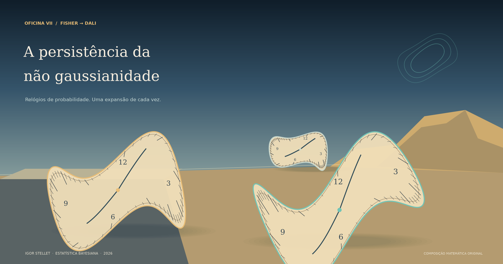
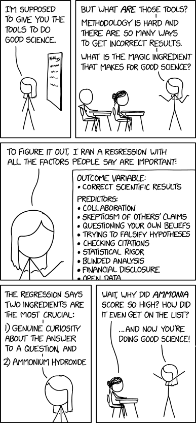

# A persistência da não Gaussianidade - Fisher e DALI

---------------------------------------------------
Tema do Projeto: Higher-Order Fisher Matrix (DALI)
Autor: Igor Stellet 
Matéria: Estatística Bayesiana, CBPF, 2026/2
---------------------------------------------------

Neste projeto, estudamos como DALI estende a aproximação de Fisher, quais não gaussianidades consegue descrever e quando aumentar a ordem melhora a inferência ou deixa de compensar pelo custo computacional. O título é inspirado em *A Persistência da Memória*, de Salvador Dalí.

O [notebook principal](projeto_dali.ipynb) reúne as hipóteses, deduções, aplicações, resultados e referências. Este README apresenta a organização dos arquivos e como executar o projeto.



Figura desenvolvida ao longo do projeto! 


## Instalação e execução

A partir da raiz do repositório, em Linux, macOS ou WSL, com Python 3.10 ou superior:

```bash
bash projeto/instalar.sh
source .venv/bin/activate
python -m jupyterlab
```

Abra `projeto/projeto_dali.ipynb` e selecione **Análise Bayesiana (.venv)**. O instalador cria ou reaproveita a `.venv` da raiz, instala os requisitos do projeto e confere seus imports. Para instalar também listas, slides e práticas, use `bash instalar.sh` na raiz. Para Windows sem WSL, siga o [README central](../README.md#windows-sem-wsl).

Mantenha as pastas `src/` e `data/` junto do notebook. Os blocos observacionais usam as cópias locais dos dados e documentam sua procedência. As cadeias, malhas e medições de tempo são executadas no próprio notebook; o tempo necessário depende da configuração e da máquina.

## Percurso do notebook

| Bloco | Conteúdo |
|---|---|
| **0** | Leitura, execução e convenções. |
| **1** | Modelo probabilístico, likelihood, priors e geometria de Fisher. |
| **2** | Construção e hipóteses da hierarquia de DALI. |
| **3** | Exemplos controlados, parametrização e modos espúrios. |
| **4** | Aplicação à Lista 3: marginais, cortes e não gaussianidades. |
| **5** | Supernovas Union2.1, calibração e comparação das aproximações. |
| **6** | BAO de BOSS DR12 e combinação com supernovas. |
| **7** | Oficina visual inspirada em Dalí e exploração interativa. |
| **8** | Precisão, custo computacional, grid e MCMC. |
| **9** | Síntese dos resultados e referências por bloco. |

## Arquivos e pastas

| Caminho | Função |
|---|---|
| [`projeto_dali.ipynb`](projeto_dali.ipynb) | Documento científico principal. |
| [`src/`](src/) | Funções reutilizáveis, documentadas no código e explicadas no notebook. |
| [`tests/`](tests/) | Testes matemáticos e numéricos dos módulos. |
| [`data/union21/`](data/union21/README.md) | Dados de supernovas, covariâncias e procedência. |
| [`data/boss_dr12/`](data/boss_dr12/README.md) | Medidas BAO, covariância e procedência. |
| [`figuras/`](figuras/) | Figuras, versões vetoriais e oficina visual em HTML. |
| [`tabelas/`](tabelas/) | Resultados, amostras e registros de configuração das análises. |
| [`requirements.txt`](requirements.txt), [`instalar.sh`](instalar.sh) e [`verificar_ambiente.py`](verificar_ambiente.py) | Instalação e conferência do ambiente. |

Os módulos de `src/` estão divididos por finalidade:

| Módulo | Conteúdo |
|---|---|
| [`dali.py`](src/dali.py) | Expansões, informação de Fisher, malhas, marginais e métricas básicas. |
| [`lista3.py`](src/lista3.py) | Modelo e comparações da questão da Lista 3. |
| [`supernovas.py`](src/supernovas.py) | Distâncias cosmológicas, calibração e análise de supernovas. |
| [`bao.py`](src/bao.py) | Observáveis BAO e combinação com supernovas. |
| [`amostragem.py`](src/amostragem.py) | Amostragem e diagnósticos das cadeias. |
| [`oficina.py`](src/oficina.py) | Modelos e expansões da oficina visual. |
| [`eficiencia.py`](src/eficiencia.py) | Precisão, cronômetros e MCMC com aceitação em duas etapas. |

## Verificação e testes

Para repetir a conferência dos imports ou executar os testes científicos, a partir da raiz:

```bash
.venv/bin/python projeto/verificar_ambiente.py
.venv/bin/python -m unittest discover -s projeto/tests -v
```

Os testes verificam propriedades analíticas e numéricas; as figuras e interpretações permanecem no notebook. Os requisitos indicam versões mínimas, e as versões utilizadas nas análises estão registradas com suas saídas.

A [oficina visual em HTML](figuras/bloco_07/oficina_visual.html) também pode ser baixada e aberta diretamente no navegador, sem kernel. As referências científicas e os créditos artísticos estão no Bloco 9 do notebook.


