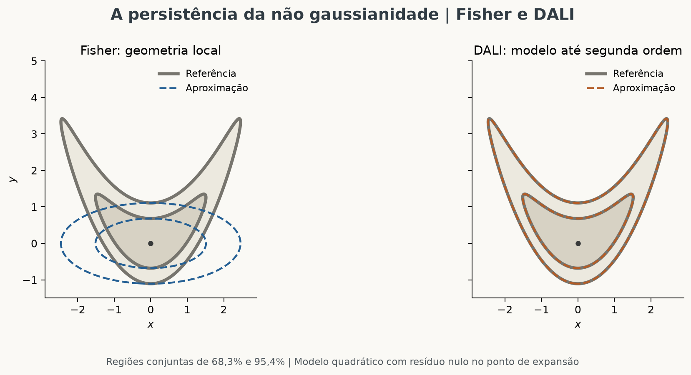

# A persistência da não Gaussianidade - Fisher e DALI

---------------------------------------------------
Tema do Projeto: Higher-Order Fisher Matrix (DALI)
Autor: Igor Stellet 
Matéria: Estatística Bayesiana, CBPF, 2026/2
---------------------------------------------------

Nesse projeto, vamos estudar como a aproximação de Fisher pode ser estendida para o método DALI (*Derivative Approximation for LIkelihoods*), quais posterior conseguimos descrever com essa aproximação e emq eu situações o aumento da ordem vale a pena ou deixa de compensar pelo seu custo computacional.

O percurso do projeto está pensado da seguinte forma: Começamos pela construção matemática do método, fazemos exemplos controlados e fazemos um exemplo da Lista 3 do curso, que evidencia o tratamento das não gaussianidades. Após essas aplicações simples, aplicamos o método em dados de supernovas, reproduzindo o artigo mostrado em sala e também aplicamos a medidas de BAO, proveniente de galáxias, buscando fazer uma aplicação nova.

O título do projeto é uma referência a obra *A Persistência da Memória*, de salvador Dali, cujo quadro pode ser visto no [MoMA](https://www.moma.org/collection/works/79018). A passagem de elipses (Fisher) para contornos deformados motiva o nome DALI e, por isso, vamos fazer como tarefa criativa tentar reproduzir as não Gaussianidades nesse projeto.


Entrega: Em um único [notebook principal](projeto_dali.ipynb), que terá todos os resultados principais, acompanhado de funções que utilizaremos de forma constante e que poder ser reaproveitadas em outros trabalhos em um módulo Python](src/dali.py) e desta documentação. O notebook contém a explicação cinetífica completa: hipóteses, deduções, implmentações, gráficos, resultados, limitações e referências.



*Figura de orientação.* Modelo com dados $d=(0,0)$, predição $\mu(x,y)=(x,y-0.55x^2)$, covariância $\operatorname{diag}(1,0.45^2)$ e priors uniformes no retângulo $x\in[-3,3]$, $y\in[-1.8,5.6]$. Os contornos encerram 68,3% e 95,4% da probabilidade conjunta de cada distribuição normalizada. A expansão do modelo até segunda ordem é exata neste exemplo. O [código da figura](figuras/gerar_visao_geral.py) acompanha os arquivos.


## Sumário | README
- [1. Sequência do notebook único](#1-sequência-do-notebook-único)
- [2. Organização e execução](#10-organização-e-execução)


## 1. Sequência do notebook único

O arquivo [projeto_dali.ipynb](projeto_dali.ipynb) é dividio em blocos. Abaixo está a divisão deles

| Bloco | Conteúdo | Resultado esperado |
|---|---|---|
| **0. Leitura e execução** | Objetivos, sumário, ambiente, convenções e configurações. | Permitir acompanhar e reproduzir o trabalho. |
| **1. Modelo probabilístico e Fisher** | Dados, likelihood, prior, posterior, informação e curvatura. | Construir a aproximação gaussiana e interpretar suas condições. |
| **2. Hierarquia de DALI** | Expansão do modelo, termos cruzados e tratamento das priors. | Derivar singleto, dubleto e tripleto. |
| **3. Exemplos controlados** | Modelos linear, quadrático, inverso e contraexemplo. | Identificar mecanismos de sucesso e falha. |
| **4. Aplicação à Lista 3** | Cortes, marginais, não gaussianidade e comparação com a questão 5. | Validar a construção quadrática e discutir o conteúdo perdido por Fisher. |
| **5. Supernovas** | Dados, cosmologia, calibração, referência e aproximações. | Reproduzir a aplicação principal do artigo. |
| **6. BAO e combinação de observáveis** | Dados comprimidos de galáxias, covariância e inferência conjunta. | Avaliar a mudança das degenerescências e da precisão. |
| **7. Oficina visual** | Posterior com contornos deformados inspirados em Dalí. | Explorar o alcance local e global das aproximações de forma ilustrativa. |
| **8. Precisão e custo** | Métricas, tempos, convergência e ponto de compensação. | Comparar desempenho com a qualidade da inferência controlada. |
| **9. Síntese e referências** | Respostas às perguntas, limitações e próximos passos. | Relacionar os resultados às hipóteses de cada estudo. |

## 2. Organização e execução

### 2.1 Arquivos iniciais e estrutura prevista

| Caminho dentro de `projeto/` | Papel | Situação |
|---|---|---|
| [`README.md`](README.md) | Planejamento, navegação, referências e acompanhamento. | Criado. |
| [`projeto_dali.ipynb`](projeto_dali.ipynb) | Único documento científico principal. | Introdução, configuração e roteiro criados; análise a desenvolver. |
| [`src/dali.py`](src/dali.py) | Funções principais reutilizáveis. | Módulo inicial; funções a desenvolver junto das derivações. |
| [`src/__init__.py`](src/__init__.py) | Organização dos módulos Python. | Criado. |
| [`figuras/gerar_visao_geral.py`](figuras/gerar_visao_geral.py) | Código da figura de orientação. | Criado e executado. |
| [`figuras/visao_geral_fisher_dali.png`](figuras/visao_geral_fisher_dali.png) e versão SVG | Figura de orientação. | Criadas. |
| `tests/` | Testes científicos e numéricos. | Planejado. |
| `data/` | Dados utilizados e sua procedência. | Planejado. |
| `tabelas/` | Tabelas geradas pelas análises. | Planejado. |
| Arquivo de requisitos e instalador do projeto | Instalação na `.venv` da raiz. | Definição ao concluir as dependências. |

 Uma documentação `.md` específica das funções poderá ser preparada ao final, depois de sua interface estar consolidada. Durante o desenvolvimento, docstrings e explicações no notebook acompanharão o código.

### 2.2 Ambiente compartilhado

O projeto seguirá a instalação incremental do [README central](../README.md). O ambiente fica na **`.venv` da raiz do repositório** e será reaproveitado pelos conjuntos de notebooks.

Para abrir o JupyterLab usando esse ambiente, a partir da raiz:

```bash
source .venv/bin/activate
python -m jupyterlab
```

Abra `projeto/projeto_dali.ipynb` e selecione o kernel **Análise Bayesiana (.venv)**. No Windows sem WSL, siga as instruções de ativação e execução do README central.

As células iniciais usam apenas a biblioteca padrão e o módulo local. Para reproduzir a figura deste README, NumPy e Matplotlib precisam estar disponíveis; ambos constam na instalação da base dos slides:

```bash
bash notebooks/exercicios_slides/instalar.sh
python projeto/figuras/gerar_visao_geral.py
```

O notebook localizará a pasta `projeto/` ao ser iniciado nessa pasta ou na raiz do repositório. Os caminhos das saídas serão construídos a partir dessa localização. As execuções caras terão configurações explícitas e as versões finais informarão como reproduzir as saídas apresentadas.

Ao concluir o projeto, prepararemos seus requisitos, seu verificador e seu instalador, além da instalação completa do repositório, sempre utilizando a mesma `.venv` da raiz.

